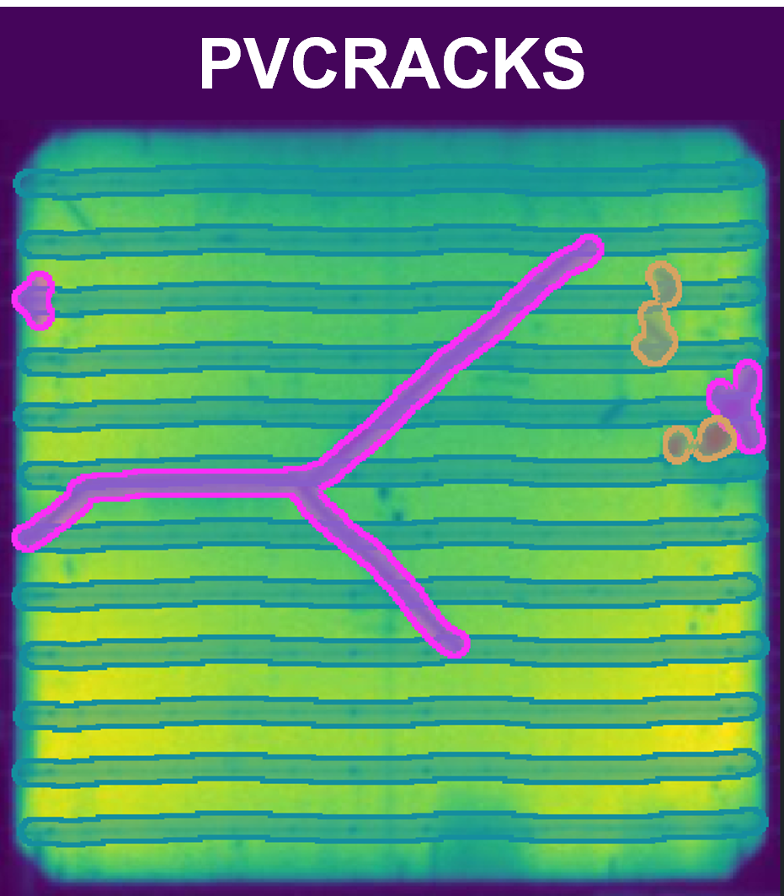
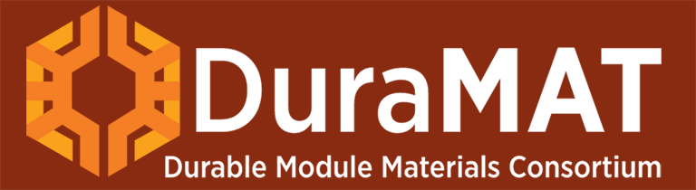
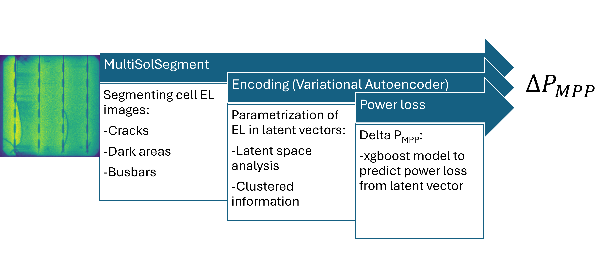

<p align="left">
  
  
</p>

# PVCracks

## Latest Release

[](https://doi.org/10.11578/dc.20240606.4)
[](https://github.com/sandialabs/pvcracks/releases/tag/v0.2.0)

## License

[](LICENSE)

## Overview

PVCracks is the DuraMAT project that investigates the effects of cracks on power loss in photovoltaic (PV) solar cells and tracks crack progression over time. We provide:

- Open-source cell-level imaging and electrical datasets  
- **MultiSolSegment**: segmentation of cracks, busbars, and dark areas in electroluminescence (EL) images  
- **3-channel autoencoder**: skip-connected mask reconstruction, embeddings, and clustering in the historical `vae` namespace
- **XGBoost model**: estimation of power loss (ΔPMPP) per cell
- **pvspice**: SPICE tools for cell, module, half-cut-module, and series-string I-V and EL simulation, including thermal, reverse-bias, and PID examples

## Documentation

[](https://pvcracks.readthedocs.io/en/latest/index.html#)

Full online documentation is available at  
https://pvcracks.readthedocs.io/en/latest/index.html#

Below is a schematic of the repo’s architecture:



## Data & Models

All datasets, trained model weights, and additional resources are hosted on DuraMAT DataHub:  
[https://datahub.duramat.org/project/pv-crack-stress-and-power-loss](https://datahub.duramat.org/project/pv-crack-stress-and-power-loss)

- Cell-level EL & electrical data (data publication to follow)  
- MultiSolSegment training images and masks (DOI: [10.21948/2587738](https://doi.org/10.21948/2587738))  
- MultiSolSegment model weights (DOI: [10.21948/2997859](https://doi.org/10.21948/2997859))
- The current 3-channel autoencoder checkpoint and matching XGBoost models are
  bundled with the package. See [model details](pvcracks/vae/README.md).
  The earlier VAE weights remain archived at DOI
  [10.21948/2997860](https://doi.org/10.21948/2997860).

## Publications

- **MultiSolSegment**  
  Published in *Solar Energy*. DOI: [10.1016/j.solener.2026.114469](https://doi.org/10.1016/j.solener.2026.114469). Preprint [10.2139/ssrn.5506469](https://dx.doi.org/10.2139/ssrn.5506469).

- **Variational Autoencoder (VAE)**  
  EUPVSEC 2024 conference proceeding  
  DOI: [10.4229/EUPVSEC2024/3BO.15.6](https://doi.org/10.4229/EUPVSEC2024/3BO.15.6)

- **Power-Loss Model (XGBoost)**  
  2025 IEEE 53rd Photovoltaic Specialists Conference (PVSC) proceeding  
  DOI: [10.1109/PVSC59419.2025.11132966](https://doi.org/10.1109/PVSC59419.2025.11132966)

## Updates

- **Nov. 10, 2025**, 1 p.m. MT —
  [*pvcracks: Quantifying the Impact of Solar Cell Cracks on PV Systems*](https://www.youtube.com/watch?v=4QWsLkpUDd4),
  presented by Norman Jost, Sandia.

## Installation

Clone and install:

```bash
git clone git@github.com:sandialabs/pvcracks.git
cd pvcracks

# 1. Upgrade pip, setuptools, and wheel
pip install --upgrade pip setuptools wheel

# 2. Install pvcracks in editable mode
pip install -e .

```

The base package includes MultiSolSegment inference, autoencoder clustering, XGBoost
prediction, and pvspice. To retrain machine-learning models or run the Ray/HPO
workflow, install the separate companion distribution:

```bash
pip install -e ./training
# Optional notebook tools: pip install -e "./training[notebooks]"
# Optional Ray/HPO tools: pip install -e "./training[hpo]"
```

See [training workflows and layout](training/README.md). The updated notebook
examples use the bundled model pair and module 209 sample masks; the XGBoost
inputs are 320 unscaled embeddings plus six original-mask measurements.

Development, documentation, and test tools are listed in `requirements-dev.txt`.

## Acknowledgments

Funding was provided as part of the Durable Modules Consortium (DuraMAT), an Energy Materials Network Consortium funded by the U.S. Department of Energy, Office of Energy Efficiency and Renewable Energy, Solar Energy Technologies Office under agreement number 32509. The views expressed in this article do not necessarily represent the views of the DOE or the U.S. Government. The U.S. Government retains—and the publisher, by accepting the article for publication, acknowledges—that it retains a nonexclusive, paid-up, irrevocable, worldwide license to publish or reproduce the published form of this work, or to allow others to do so, for U.S. Government purposes.

Sandia National Laboratories is a multimission laboratory managed and operated by National Technology and Engineering Solutions of Sandia, LLC, a wholly owned subsidiary of Honeywell International Inc., for the U.S. Department of Energy’s National Nuclear Security Administration under contract DE-NA0003525.

